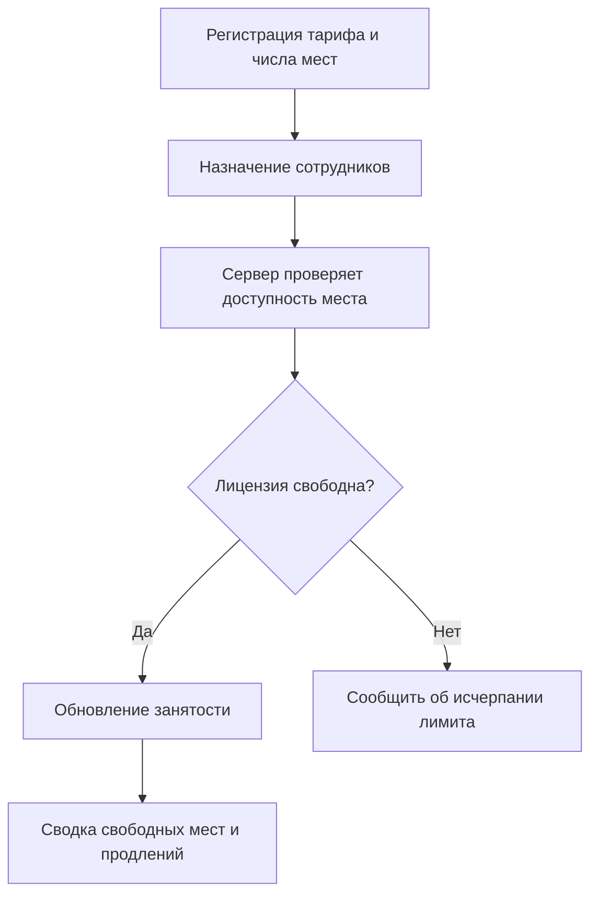

# 226 · Учёт подписок команды

Репозиторий `team-subscription-tracker` · приложение с сервером

**Продукт и интерфейс.** Операционный менеджер добавляет сервисы, тарифы, период оплаты, занятые места и даты продления. В карточке назначает место сотруднику. Сводка показывает предстоящие платежи, текущую загрузку и свободные лицензии.

**Архитектура и данные.** React, FastAPI и SQLite. Таблицы сервисов, подписок, сотрудников и назначений. API вычисляет свободные места и платежи из сохранённых сумм и дат. Суммы хранятся в минимальных единицах валюты, сводка группируется по валютам. Назначение места и проверка лимита выполняются в одной транзакции. Интеграции и ML не нужны.

**Блок-схема основного сценария**

**Функциональные правила.** Свободные места равны лимиту минус активные назначения. Для сводки использовать введённую дату продления и сумму периода, денежные итоги разделять по валютам. Архивное назначение освобождает место и остаётся в истории.

**Контракты реализации.** API `GET /subscriptions`, `POST /subscriptions/{id}/assignments`, `POST /assignments/{id}/release` и `GET /renewals?within_days=30`. Ограничения проверяют вместимость и одно активное назначение сотруднику в подписке.

**Проверки граничных случаев.** Проверить конкурентный запрос на последнее место, повторное назначение того же сотрудника и сводку из двух валют.

**Разработка и приёмка.** Поднять каталог и карточку подписки, затем назначения, сводку и экспорт. В демоподписке с пятью местами и четырьмя назначениями последний слот можно занять, шестого пользователя добавить нельзя. Продление через семь дней видно в списке платежей.
